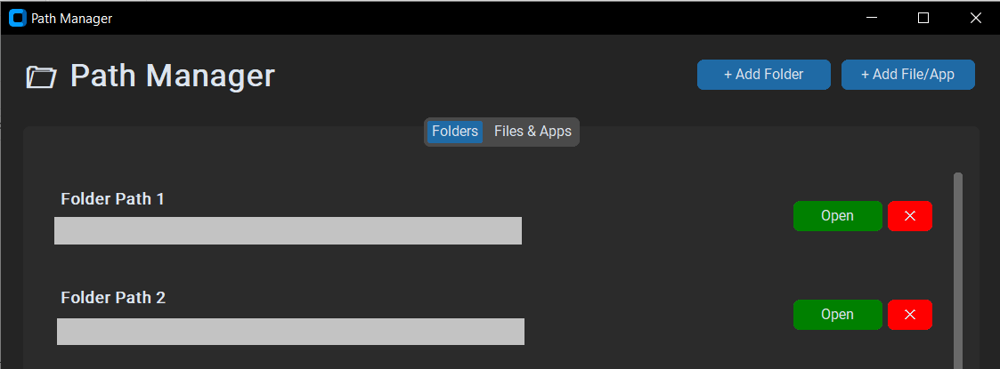
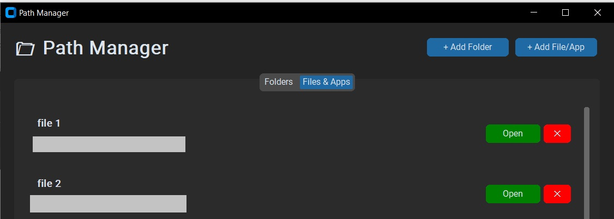

# Path Manager
A sleek, desktop application built with Python and CustomTkinter to help you organize and quickly access frequently used folders, files, and applications. Say goodbye to digging through deep directory trees.
### Folder Path

### File Path


## ✨ Features
- **Dual Category Management:** Separate tabs for organizing directory paths and executable files/apps.

- **Modern UI:** A dark-themed, responsive interface using the CustomTkinter library.

- **Persistent Storage:** Automatically saves your paths to a local json file, so they are ready when you restart.

- **Cross-Platform:** Smart path launching that works seamlessly across Windows, macOS, and Linux.

- **Custom Naming:** Give your paths friendly aliases (e.g., name C:/Users/Work/Project/V1/Assets simply as "Project Assets").

## 🚀 Getting Started
- **Prerequisites :**
You will need Python installed on your system. You can install the required GUI library via pip:

    ```Bash
    pip install customtkinter
    ```
- **Installation & Usage:** Clone this repository or download the source code.

- **Navigate to the project directory:**  Run the application:

    ```Bash
    python main.py
    ```
## 🛠️ How It Works
- **Adding Paths:** Click the `+ Add Folder or + Add File/App buttons`. Select your target using the system dialog, and then provide a nickname for the entry.

- **Opening:** Click the `green Open button` to launch the file or open the folder in your system's default file explorer.

- **Deleting:** Click the `red ✕ button` to remove an entry from your list.

## 🏗️ Technical Architecture
-The app follows a modular structure for easy maintenance:

- **PathManager:** Logic for JSON serialization and data handling.

- **PathLauncher:** Static methods to handle OS-specific shell commands.

- **PathCard:** A custom UI component for consistent entry rendering.

- **PathManagerApp:** The main interface and event loop controller.

## 📝 License
This project is open-source and available under the MIT License.

## Future Enhancements
- [ ] Drag-and-drop support for adding paths.

- [ ] Search bar for filtering long lists.

- [ ] Custom icon support for path cards.